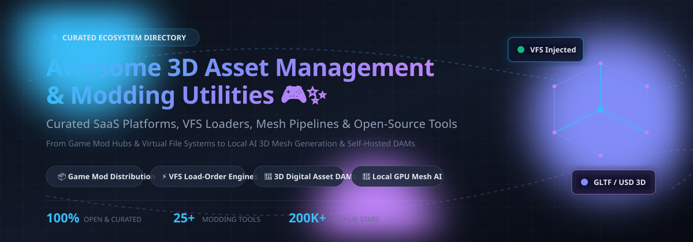

# Awesome 3D Asset Management & Modding Utilities 🎮✨

<p align="center">
  
</p>

<p align="center">
  <a href="https://github.com/ishandutta2007/Awesome-Awesome-Awesome"></a><a href="https://discord.gg/jc4xtF58Ve"></a>
  <a href="https://github.com/ishandutta2007/Awesome-3D-Asset-Management-Modding-Utilities/stargazers"></a>
  <a href="https://github.com/ishandutta2007/Awesome-3D-Asset-Management-Modding-Utilities/network/members"></a>
  <a href="https://github.com/ishandutta2007/Awesome-3D-Asset-Management-Modding-Utilities/blob/main/LICENSE"></a>
  <a href="https://github.com/ishandutta2007"></a>
</p>

---

## 🧭 Comprehensive Overview & Ecosystem Directory

Welcome to **Awesome 3D Asset Management & Modding Utilities** — a curated index of enterprise SaaS platforms, local game mod managers, virtual file-system (VFS) loaders, self-hosted 3D digital asset management (DAM) libraries, and open-source 3D mesh processing pipelines.

Whether you are a **game modder**, **technical artist**, **indie game developer**, or **3D pipeline engineer**, this directory catalogs the essential software and libraries required to organize, inject, inspect, convert, and distribute 3D models and mod modifications seamlessly.

### 🔍 Quick Navigation
- [📊 Sector Overview & Market Dynamics](#-sector-overview--market-dynamics)
- [☁️ SaaS & Hosted Platforms](#️-saas--hosted-platforms)
- [💻 Open-Source Repositories & Tools](#-open-source-repositories--tools)
- [🛠️ Modding Pipeline Architecture](#️-modding-pipeline-architecture)
- [🤝 How to Contribute](#-how-to-contribute)
- [💖 Support & Sponsorship](#-support--sponsorship)
- [📈 Star History](#-star-history)
- [📜 Disclaimer](#-disclaimer)

---

## 📊 Sector Overview & Market Dynamics

> The global video game modding tools and creator-economy ecosystem was estimated at **$1.45 billion in 2024** and is projected to expand significantly as user-generated content (UGC) spending approaches **$10B+ to $25B+** across integrated platform economies. 
> 
> The sector exhibits a **highly concentrated ("winner-take-all") market structure** in centralized distribution hubs (dominated by Valve's Steam Workshop, Nexus Mods, and Overwolf / CurseForge due to powerful network effects), while displaying **moderate fragmentation** across specialized local mod injection clients, virtual file systems, and emerging open-source 3D digital asset management (DAM) utilities.

---

## ☁️ SaaS & Hosted Platforms

Below is a detailed analysis of leading commercial hosted platforms and SaaS providers serving 3D digital assets, game modification catalogs, and community modding infrastructure. Products are sorted in **descending order by company valuation / annual revenue scale**.

| Platform | Description | Company Scale (Valuation / Revenue) | Starting Pricing Tier | Free Tier Limits & Trial Policy |
| :--- | :--- | :--- | :--- | :--- |
| **[Steam Workshop](https://steamcommunity.com)** | Integrated game content distribution platform offering one-click 3D mod subscriptions and automated cloud sync. | **$8B – $10B+ Valuation** (~$4B+ annual platform commission revenue; Valve Corporation) | **Free to End-Users** (100% free browse/download); Game publishers pay **$100 recoupable fee per game app** via Steam Direct | **Free Forever**: Unlimited mod downloads and cloud sync for owners of supported games on Steam. |
| **[Overwolf](https://overwolf.com)** | Commercial desktop overlay and modding app framework powering game extensions and creator monetization. | **$500M+ Valuation** ($150M+ total venture funding; $300M+ creator payouts in 2025) | **Free with in-app ads**; Creator monetization split takes **30% commission** on ad revenue | **Free Forever**: Completely free access to community overlay apps and mod tools supported by display ads. |
| **[CurseForge](https://curseforge.com)** | Managed mod repository and client handling dependency resolution, modpacks, and creator payouts (Overwolf subsidiary). | **$200M+ Division Scale** (Part of Overwolf; acquires ~500k+ hosted mods) | **$2.99 / month** (CurseForge Premium ad-free subscription, or $2.50/mo billed annually at $30/yr) | **Free Forever**: Unlimited mod and modpack downloads with standard download queues and non-intrusive display ads. |
| **[Sketchfab](https://sketchfab.com)** | Leading cloud 3D model viewer, asset marketplace, and portfolio management platform (Epic Games subsidiary). | **$100M+ Scale** (Acquired by Epic Games; $10M+ prior funding, ~$8.4M ARR) | **$15 / month** (Sketchfab Pro starting plan); Marketplace takes **12% standard commission** | **Free Plan**: Free forever with up to 10 public 3D uploads per month (max 100MB per model file, CC attribution). |
| **[echo3D](https://echo3d.com)** | Enterprise cloud 3D digital asset management (DAM), spatial compression, and WebAR/Web3D streaming engine. | **$35M – $50M Valuation** ($9.6M total venture capital funding from Qualcomm & Techstars) | **$99 / month** (Pro Developer plan for production APIs and unbranded streaming) | **Free Forever Plan**: 10 monthly credits (~100 API calls, 1 GB asset cloud storage, 250 MB streaming bandwidth, watermarked WebAR). |
| **[Nexus Mods](https://nexusmods.com)** | The largest independent PC game modding distribution platform hosting millions of 3D models and curated Collections. | **$15M – $25M Valuation** (~$10M estimated annual revenue; independently owned) | **$8.99 / month** (Nexus Premium monthly, or $89.99/year for uncapped bandwidth) | **Free Forever**: Full access to all mods, capped at **1.5 MB/s to 3.0 MB/s download speed** with banner ads and manual multi-file queues. |
| **[Modrinth](https://modrinth.com)** | High-speed, creator-centric mod and asset repository featuring modern APIs and open-source desktop clients. | **$3M – $6M Valuation** (Self-sustaining community platform; $1M+ creator payouts) | **$5.00 / month** (Modrinth+ supporter plan with profile badges and ad removal) | **Free Forever**: 100% uncapped high-speed downloads, unlimited modpack hosting, full public API access, and zero paywalled content. |
| **[Mod DB](https://moddb.com)** | Long-running community portal and CDN dedicated to total conversions, 3D skin mods, and game preservation (DBolical). | **$2M – $5M Valuation** (DBolical Pty Ltd; independent Australian private media company) | **Free community platform** (Funded via programmatic display advertising and publisher partnerships) | **Free Forever**: Completely free and unlimited downloads of full game conversions and 3D files without mandatory registration. |
| **[GameBanana](https://gamebanana.com)** | Community-driven asset hub specializing in 3D game skins, audio replacements, map ports, and WIP feedback. | **$1M – $3M Valuation** (Independent privately operated community portal) | **~$3.00 – $5.00 / month** equivalent (GameBanana "Ripe" Supporter membership or redeemable via 10,000–20,000 Banana Points) | **Free Forever**: Unlimited download speeds, mod submissions, feedback participation, and community guides supported by display ads. |
| **[ModDrop](https://moddrop.com)** | Multi-game desktop mod manager and sync client featuring cloud saves, profile sharing, and automated installations. | **$500K – $1.5M Valuation** (Privately held boutique developer tool) | **$2.99 / month** (ModDrop Plus optional premium tier for cloud modpack backup extension) | **Free Forever**: Full multi-game mod installer, offline mode, and profile manager with local disk caching. |
| **[LoversLab](https://loverslab.com)** | High-volume independent adult gaming community and archive hosting advanced custom 3D skeletons and physics frameworks. | **$500K – $1M Valuation** (Privately funded enthusiast community) | **Free / Donation-based** (Community voluntary patronage to offset high bandwidth servers) | **Free Forever**: Uncapped downloads, full forum search, and asset distribution across all community threads without payment. |

---

## 💻 Open-Source Repositories & Tools

Open-source utilities empower mod authors, technical directors, and enthusiasts to inspect game archives, manage load orders, and run local GPU mesh generation pipelines without vendor lock-in.

The table below is **sorted in descending order by GitHub Stars_Count**:

| Repository | Project Focus | GitHub_Stars | License |
| :--- | :--- | :--- | :--- |
| **[godotengine/godot](https://github.com/godotengine/godot)** | Feature-packed multi-platform 2D/3D game engine with complete FBX, glTF, and runtime modding pipelines. | [](https://github.com/godotengine/godot/stargazers) | `MIT` |
| **[mrdoob/three.js](https://github.com/mrdoob/three.js)** | Foundational WebGL/WebGPU 3D library powering web-based 3D digital asset previewers and browser DAMs. | [](https://github.com/mrdoob/three.js/stargazers) | `MIT` |
| **[FreeCAD/FreeCAD](https://github.com/FreeCAD/FreeCAD)** | Open-source parametric 3D CAD modeler supporting advanced mesh inspection, conversion, and repair. | [](https://github.com/FreeCAD/FreeCAD/stargazers) | `LGPL-2.0+` |
| **[assimp/assimp](https://github.com/assimp/assimp)** | Universal Open Asset Import Library supporting 40+ 3D model formats into a unified mesh and bone structure. | [](https://github.com/assimp/assimp/stargazers) | `BSD-3-Clause` |
| **[PrismLauncher/PrismLauncher](https://github.com/PrismLauncher/PrismLauncher)** | Community launcher with native Modrinth & CurseForge API integration, isolated instances, and mod sync. | [](https://github.com/PrismLauncher/PrismLauncher/stargazers) | `GPL-3.0` |
| **[BepInEx/BepInEx](https://github.com/BepInEx/BepInEx)** | De-facto standard IL2CPP & Mono runtime plugin injector and asset override framework for Unity games. | [](https://github.com/BepInEx/BepInEx/stargazers) | `LGPL-2.1` |
| **[AssetRipper/AssetRipper](https://github.com/AssetRipper/AssetRipper)** | GUI and CLI tool to extract, decompile, and convert Unity engine serialized 3D meshes, textures, and scenes. | [](https://github.com/AssetRipper/AssetRipper/stargazers) | `GPL-3.0` |
| **[lightningpixel/modly](https://github.com/lightningpixel/modly)** | Desktop application generating and managing 3D `.glb` meshes from text/images locally on GPU via extensions. | [](https://github.com/lightningpixel/modly/stargazers) | `MIT` |
| **[KhronosGroup/glTF](https://github.com/KhronosGroup/glTF)** | The 3D runtime asset format standard specification and toolset for efficient 3D asset transmission and loading. | [](https://github.com/KhronosGroup/glTF/stargazers) | `Apache-2.0` |
| **[LavaGang/MelonLoader](https://github.com/LavaGang/MelonLoader)** | Universal cross-platform IL2CPP / Mono mod loader for Unity games with comprehensive native hooks. | [](https://github.com/LavaGang/MelonLoader/stargazers) | `Apache-2.0` |
| **[4sval/FModel](https://github.com/4sval/FModel)** | Unreal Engine archive explorer and 3D asset extractor supporting audio, textures, and Skeletal Meshes. | [](https://github.com/4sval/FModel/stargazers) | `GPL-3.0` |
| **[UE4SS-RE/RE-UE4SS](https://github.com/UE4SS-RE/RE-UE4SS)** | Unreal Engine 4/5 scripting system, C++ API, and live UObject hook generator for dynamic modding. | [](https://github.com/UE4SS-RE/RE-UE4SS/stargazers) | `MIT` |
| **[ModOrganizer2/modorganizer](https://github.com/ModOrganizer2/modorganizer)** | Benchmark PC mod manager utilizing a non-destructive Virtual File System (USVFS) for asset overrides. | [](https://github.com/ModOrganizer2/modorganizer/stargazers) | `GPL-3.0` |
| **[modrinth/theseus](https://github.com/modrinth/theseus)** | High-speed modern mod manager and desktop client built with Rust and Tauri for Modrinth ecosystem. | [](https://github.com/modrinth/theseus/stargazers) | `GPL-3.0` |
| **[ebkr/r2modmanPlus](https://github.com/ebkr/r2modmanPlus)** | Cross-platform desktop manager for Thunderstore packages with profile export and BepInEx injection. | [](https://github.com/ebkr/r2modmanPlus/stargazers) | `MIT` |
| **[manyfold3d/manyfold](https://github.com/manyfold3d/manyfold)** | Self-hosted 3D digital asset manager (DAM) for cataloging, previewing in Three.js, tagging, and sharing 3D files. | [](https://github.com/manyfold3d/manyfold/stargazers) | `MIT` |
| **[CesiumGS/gltf-pipeline](https://github.com/CesiumGS/gltf-pipeline)** | Content pipeline tools for 3D glTF optimization, Draco geometry compression, and format conversion. | [](https://github.com/CesiumGS/gltf-pipeline/stargazers) | `Apache-2.0` |
| **[loot/loot](https://github.com/loot/loot)** | Automated load order optimization tool calculating dependency graphs and plugin priority sorting. | [](https://github.com/loot/loot/stargazers) | `GPL-3.0` |
| **[Nexus-Mods/Vortex](https://github.com/Nexus-Mods/Vortex)** | Official multi-game mod manager from Nexus Mods featuring LOOT integration and conflict management for 250+ titles. | [](https://github.com/Nexus-Mods/Vortex/stargazers) | `GPL-3.0` |
| **[RimSort/RimSort](https://github.com/RimSort/RimSort)** | Cross-platform mod manager and dependency sorter built in Python with Steam Workshop integration. | [](https://github.com/RimSort/RimSort/stargazers) | `GPL-3.0` |
| **[Nexus-Mods/Nexus-Mod-Manager](https://github.com/Nexus-Mods/Nexus-Mod-Manager)** | Community-maintained classic mod manager offering archive installation and multi-game management. | [](https://github.com/Nexus-Mods/Nexus-Mod-Manager/stargazers) | `GPL-2.0` |
| **[atenfyr/UAssetGUI](https://github.com/atenfyr/UAssetGUI)** | Low-level GUI viewer and raw node editor for modifying serialized Unreal Engine `.uasset` & `.umap` files. | [](https://github.com/atenfyr/UAssetGUI/stargazers) | `MIT` |
| **[Reloaded-Project/Reloaded-II](https://github.com/Reloaded-Project/Reloaded-II)** | Universal .NET Core powered modding framework and native hook injector for x86/x64 executables. | [](https://github.com/Reloaded-Project/Reloaded-II/stargazers) | `GPL-3.0` |
| **[wabbajack-tools/wabbajack](https://github.com/wabbajack-tools/wabbajack)** | Automated modlist installer replicating massive multi-hundred gigabyte setups with binary patches. | [](https://github.com/wabbajack-tools/wabbajack/stargazers) | `GPL-3.0` |
| **[TES5Edit/TES5Edit](https://github.com/TES5Edit/TES5Edit)** | Advanced graphical module editor (xEdit / SSEEdit) for Bethesda titles to clean mods and resolve 3D record conflicts. | [](https://github.com/TES5Edit/TES5Edit/stargazers) | `GPL-3.0` |
| **[Kesomannen/gale](https://github.com/Kesomannen/gale)** | Modern, fast, lightweight Thunderstore mod manager written in Svelte and Tauri utilizing symlink storage. | [](https://github.com/Kesomannen/gale/stargazers) | `GPL-3.0` |
| **[iquercorb/OpenModMan](https://github.com/iquercorb/OpenModMan)** | Generic package and mod manager supporting delta restoration, presets, and decentralized XML repositories. | [](https://github.com/iquercorb/OpenModMan/stargazers) | `GPL-3.0` |
| **[fernandotonon/QtMeshEditor](https://github.com/fernandotonon/QtMeshEditor)** | Open-source 3D mesh utility supporting 40+ formats, LOD computation, animation merging, and batch conversion. | [](https://github.com/fernandotonon/QtMeshEditor/stargazers) | `MIT` |

---

## 🛠️ Modding Pipeline Architecture

When constructing a custom production pipeline or automated workflow for 3D game modding, recommended modular stacks include:

```
┌─────────────────────────────────────────────────────────────┐
│                 1. 3D ASSET AUTHORING & AI                  │
│     [Blender / FreeCAD] + [lightningpixel/modly] (GPU Mesh)  │
└──────────────────────────────┬──────────────────────────────┘
                               │
                               ▼
┌─────────────────────────────────────────────────────────────┐
│                 2. INSPECTION & CONVERSION                  │
│      [assimp] + [AssetRipper / FModel] + [QtMeshEditor]     │
└──────────────────────────────┬──────────────────────────────┘
                               │
                               ▼
┌─────────────────────────────────────────────────────────────┐
│                 3. CATALOGING & PREVIEW                     │
│          [Manyfold (Self-Hosted DAM)] / [echo3D]            │
└──────────────────────────────┬──────────────────────────────┘
                               │
                               ▼
┌─────────────────────────────────────────────────────────────┐
│                 4. VFS INJECTION & PACKAGING                │
│       [Mod Organizer 2 (USVFS)] / [BepInEx / Reloaded-II]   │
└──────────────────────────────┬──────────────────────────────┘
                               │
                               ▼
┌─────────────────────────────────────────────────────────────┐
│                 5. DISTRIBUTION & MODPACKS                  │
│       [Nexus Mods / Modrinth / CurseForge] + [Wabbajack]    │
└─────────────────────────────────────────────────────────────┘
```

---

## 🤝 How to Contribute

We welcome additions, corrections, and tool submissions from mod authors, game artists, and software developers!

1. 🍴 **Fork the repository** on GitHub.
2. 🌿 **Create a new branch**: `git checkout -b feature/add-new-utility`.
3. 📝 **Add your tool** to `README.md` keeping the tabular structure and factual descriptions intact.
4. ⭐ **Include details**: Ensure you specify pricing, free limits, official license, and stargazers badge.
5. 🚀 **Submit a Pull Request** with a brief summary of the project's utility and active status.

---

## 💖 Support & Sponsorship

If you find this curated directory helpful for your game modding journey, technical art pipelines, or developer workflows:

- ⭐ **Star this repository** to help others discover it!
- 🍴 **Fork it** to maintain your personal reference stack.
- 📢 **Share it** with modding and 3D developer communities on Discord, Reddit, and Twitter.
- ☕ **Buy a coffee or sponsor development**: Visit the **[GitHub Sponsors Dashboard](https://github.com/sponsors/ishandutta2007)** to support ongoing maintenance and curation of open-source resources!

---

## 📈 Star History

[](https://www.star-history.com/#ishandutta2007/Awesome-3D-Asset-Management-Modding-Utilities&type=date&legend=top-left)

---

## 📜 Disclaimer

- This directory is a **community-curated collection** provided for educational, preservation, and pipeline development purposes.
- Modification, extraction, or reverse-engineering of game assets must strictly adhere to each respective video game publisher's **Terms of Service (ToS)**, **End User License Agreement (EULA)**, and modding policies.
- Always inspect third-party binary hooks (`.dll`, `.asi`, script extenders) and verify checksums before installation.

---

<p align="center">
  <b>Built with ❤️ for 3D technical artists, modders, and game preservationists worldwide.</b><br />
  <sub>Explore more curated lists on <a href="https://github.com/ishandutta2007/Awesome-Awesome-Awesome">Awesome-Awesome-Awesome</a>.</sub>
</p>
